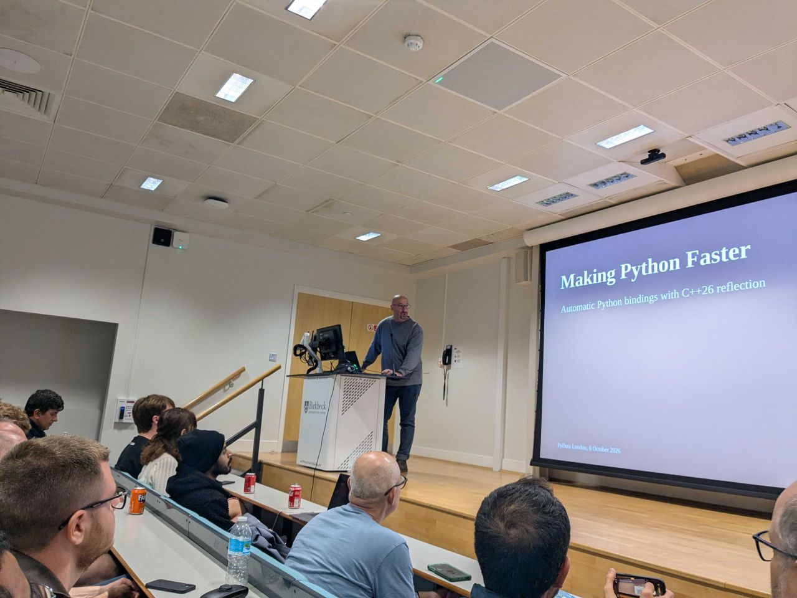

# Richard Hickling

**Financial markets technologist · Technical delivery leader · Fintech co-founder**

London, UK · [LinkedIn](https://www.linkedin.com/in/rthickling) · [GitHub](https://github.com/rthickling)

I combine hands-on C++ and Python engineering with product direction and delivery leadership. My experience spans investment banking, exchange infrastructure and algorithmic trading, connecting the needs of traders, quants and business teams with the systems that support them.

## What I bring

- **Trading and risk technology:** derivatives pricing, risk analytics, exchange connectivity, order entry and distributed systems.
- **Technical delivery:** architecture, cross-team coordination and delivery across front office, risk, operations and production.
- **Product and partnerships:** fintech product direction, exchange partnerships, developer education and translating complex technology into practical tools.

## Selected experience

-  — **Co-founder, 2019–present.** Product direction, partnerships and technical delivery for an algorithmic trading platform, including the BitMEX Bots partnership.
-  **[Bank of America Merrill Lynch](https://www.bankofamerica.com/), 2019.** Python development for full-revaluation VaR in Quartz.
-  **2018.** Distributed C++/Python pricing and risk systems.
-  — **Optiq, 2016–2017.** Core C++ exchange development and technical project leadership, including event-driven architecture, FIX interfaces, recovery and pre-trade risk controls.
-  **[Morgan Stanley](https://www.morganstanley.com/), 2012–2014.** Technical programme leadership across equity derivatives and front-to-back workflows.
-  **[Macquarie](https://www.macquarie.com/uk/en.html), 2010–2011.** Led OTC equity derivatives projects, including structured-product trade capture and lifecycle integration.
-  **[Barclays](https://home.barclays/), 2008–2010 and 2014–2016.** Led 11 senior risk developers across four locations; later developed cross-asset risk analytics and P&L attribution in C++.

## Consulting and education

-  **[Alertatron](https://alertatron.com/) — Technical consultancy.** Secured and delivered consulting work analysing, diagramming and documenting Alertatron's technical system to support technical due diligence.
-  **[Hong Kong Baptist University](https://www.hkbu.edu.hk/) — Algorithmic trading education.** Led ProfitView's education partnership supporting Python strategy development and simulated trading. Delivered an MSc Finance guest lecture on 20 May 2025, with supporting Python examples. [FIN 7850: Algorithmic and High-Frequency Trading](https://handbook.ar.hkbu.edu.hk/2026-2027/course/FIN7850) · [MSc Finance programme](https://mscfinance-fintech.hkbu.edu.hk/programme/curriculum.html) · [Guest lecture materials](https://github.com/profitviews/mscfinance.hkbu.2025).
-  **[Hong Kong Polytechnic University](https://www.polyu.edu.hk/) — Algorithmic trading education.** Led ProfitView's education partnership supporting team-based Python trading strategies, simulated markets, competitions and student presentations. [Quantitative Finance and FinTech programme](https://www.polyu.edu.hk/ama/study/ug/amfa/) · Related course: [AMA4370 — Applied Algorithmic Trading Strategies](https://www.polyu.edu.hk/ama/information/undergraduate/AMA4370.pdf).

## Talks and community

I organise [Algorithmic Trading, London](https://www.meetup.com/algorithmic-trading-london/) and [London Quant Club](https://www.meetup.com/london-quant-club/), bringing traders, developers and quants together around practical trading technology.

*Presenting “Making Python Faster” at PyData London, Birkbeck, 6 October 2026.*

- **[Making Python Faster](https://www.meetup.com/pydata-london-meetup/events/316770322/)** — PyData London, 6 October 2026. Lightning talk on Python/C++ interoperability and reflection-generated bindings.
- **Why Python is the best language for algorithmic trading** — [PyData London's 100th Meetup](https://www.meetup.com/pydata-london-meetup/), 7 October 2025. Python trading workflows and a live bot demonstration.
- **[C++ and Python for Algorithmic Trading](https://profitview.net/events/cpp-python-algo-trading)** — ProfitView, 20 December 2022. My presentation on retrieving Parquet trading data in C++ and displaying it through Python, alongside talks by Antony Peacock and Rainer Grimm.
- **[Getting Started with Trading Bots](https://profitview.net/events/getting-started-with-trading-bots)** 8 December 2023. Co-presenter, covering fundamentals and deploying a starter bot from GitHub.

[More presentations and webinars](talks.md), including the ProfitView / HKU SPACE series on signals and backtesting.

## Selected projects

These public demonstrations explore the engineering behind trading and financial products.

- **[Exotica](https://github.com/rthickling/exotica)** — A structured-products sales and lifecycle demonstrator: Angular, Java/Spring, PostgreSQL and Python/QuantLib. Model valuation and service integration, with simulated commercial activity and settlement.
- **[Merton Market Maker](https://github.com/rthickling/merton-market-maker)** — Online jump-diffusion calibration in C++, with reflection-generated Python bindings and illustrative paper quoting. An engineering demonstration, presented at PyData London.
- **[Compute Trade](https://github.com/rthickling/compute-trade)** — An educational C++ exchange for computation resources, using Simplx actors, SBE messaging, a TCP order gateway and price/time matching.

More projects — trading infrastructure, blockchain and AI experiments

- **[simplx](https://github.com/rthickling/simplx)** — C++ framework for concurrent distributed systems, originally developed by Tredzone.
- **[equity-ops-lab](https://github.com/rthickling/equity-ops-lab)** — Prototype equity trade-event processing with Kafka, Avro and SQLite.
- **[crypto-stock](https://github.com/rthickling/crypto-stock)** — Python example comparing IBIT ETF and BitMEX Bitcoin perpetual prices.
- **[bitcoin-wallet](https://github.com/rthickling/bitcoin-wallet)** — Educational Python notebook exploring Bitcoin keys, addresses and transaction signing.
- **[vault-face](https://github.com/rthickling/vault-face)** — Experimental DeFiChain vault signals for ProfitView and WOO X.
- **[news-droid](https://github.com/rthickling/news-droid)** — Experimental cryptocurrency news-sentiment analysis and trading bot for ProfitView.
- **[bf-sqlite](https://github.com/rthickling/bf-sqlite)** — Experimental SQLite file-format reads and controlled writes using Brainfuck.
- **[welcome-to-the-machine](https://github.com/rthickling/welcome-to-the-machine)** — Machine-code experiments with executable binaries, byte-level explanations and verifiers.

## Technical toolkit

C++ · Python · Java · SQL · KDB/q · Kafka · FIX/SBE · Linux · Docker

## Education

**BSc Mathematics and Philosophy — University of Western Australia**

## Connect

For my wider professional background or a conversation about trading technology, technical delivery or fintech products, find me on [LinkedIn](https://www.linkedin.com/in/rthickling).

<!--
Future additions as this profile grows into a fuller public CV:
- Short case studies: problem, personal contribution, trade-offs, validation and outcome.
- Public slides, recordings, articles and further technical teaching materials.
- A downloadable CV prepared specifically for public sharing.
Keep demonstrations clearly labelled and add quantified outcomes only when verified.
-->
